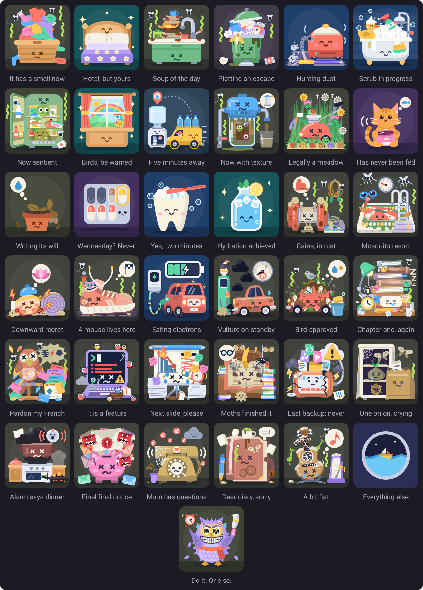
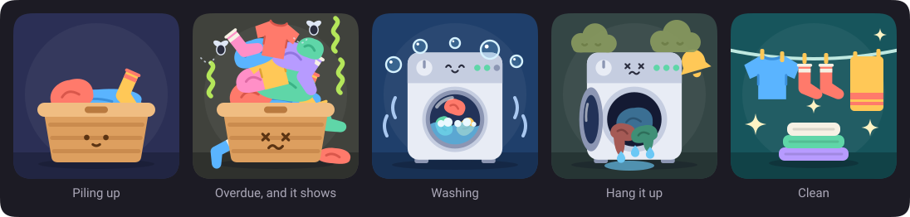
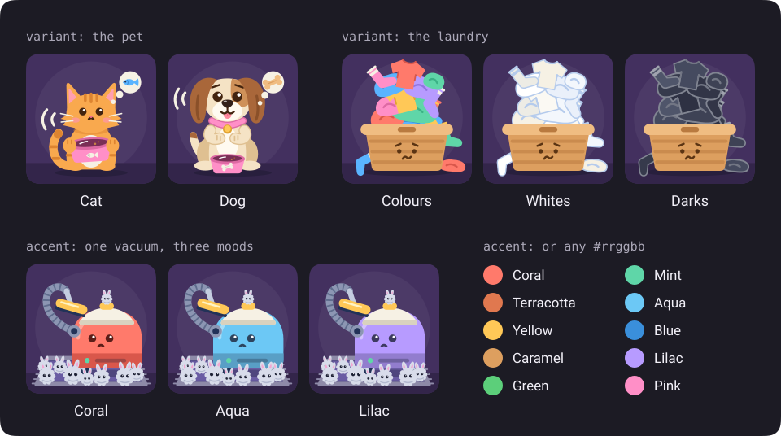
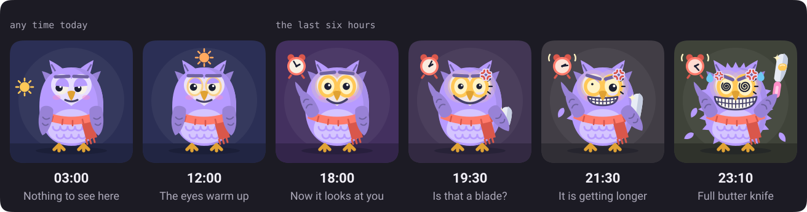
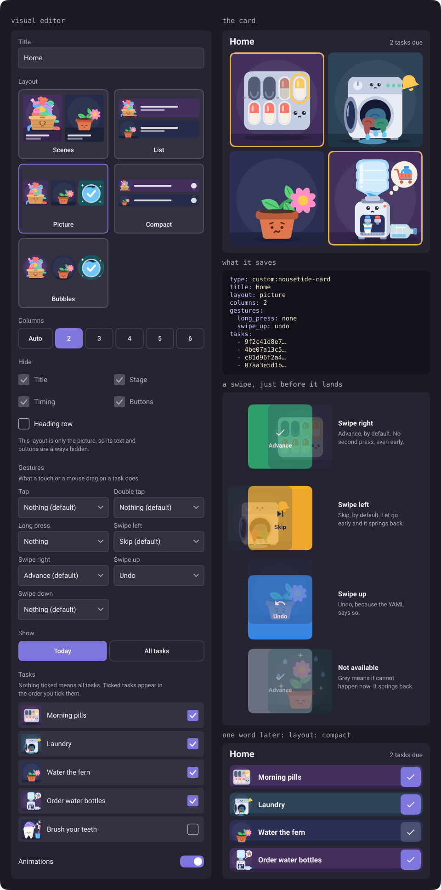
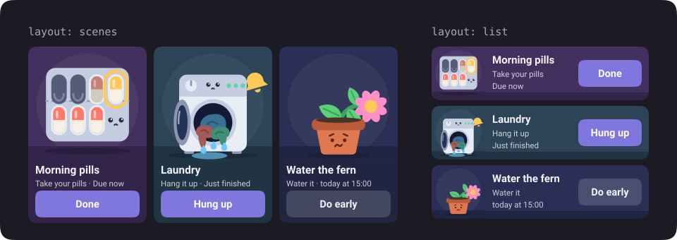

<div align="center">

# Housetide

**Recurring chores for Home Assistant, with a washing machine that actually rumbles.**

[](https://github.com/kriakiku/housetide/releases/latest)
[](https://github.com/kriakiku/housetide/actions/workflows/ci.yml)
[](https://github.com/kriakiku/housetide#install)
[](https://github.com/kriakiku/housetide/blob/main/LICENSE)



</div>

Chores come back. That is the whole problem.

Housetide keeps the pills, the laundry and the one-off errands in one place, and draws each of them as a small scene that gets worse while you look away. The laundry pile grows. Then it smells. Then it has flies. Nobody nags you. The basket just looks at you.

A task can be a chain of steps, and a sensor can move it along. The laundry marks itself as started when the washer draws power, and turns into "hang it up" when the washer goes quiet. You did not tap anything. You were busy not doing the laundry.

## Install

You need Home Assistant 2026.3 or newer. Housetide runs on Python 3.14, and that is the first release that does.

**Marketplace (Home Assistant 2026.11 and newer).** Open `/marketplace`, choose **Add from link** and paste `https://github.com/kriakiku/housetide`. The first time, you are asked to connect GitHub with a short code. Install Housetide and restart Home Assistant.

**HACS (older versions).** Add `https://github.com/kriakiku/housetide` under **Custom repositories** with the type **Integration**, or press the button. Download it and restart Home Assistant.

[](https://my.home-assistant.io/redirect/hacs_repository/?owner=kriakiku&repository=housetide&category=integration)

**By hand.** Copy `custom_components/housetide` to your `custom_components` folder and restart Home Assistant.

Then add the integration. Go to **Settings → Devices & services → Add integration** and pick **Housetide**, or press this one. There is nothing to fill in.

[](https://my.home-assistant.io/redirect/config_flow_start/?domain=housetide)

A **Housetide** item appears in the sidebar, and the card appears in the dashboard card picker.

## Your first task in a minute

1. Open **Housetide** in the sidebar and go to **Tasks**.
2. Under **New task**, tap a template. **Pills** will do.
3. The editor opens with everything filled in. Change the time if 08:00 is not a time you have ever been awake. Press **Save**.
4. Go back to **Today**. Your task is there, or under **Coming up** if its time has already passed today.
5. When it is due, tap the big button. If it is not due yet, the button says **Do early**, then **Sure?**, and wants a second tap, because thumbs are not to be trusted.

Regretted it? A small undo button appears right after.

## The cast

Thirty-seven scenes, one job each: make you feel something about your household.

<p align="center">
  
</p>

And the star of the show has its own album.

<p align="center">
  
</p>

## Make a scene yours

A scene does not have to come as drawn. Open a task and find **Look**, which has a live preview, so you can see the damage before you save it.

<p align="center">
  
</p>

- **Accent colour** repaints the main thing in the scene: the vacuum, the bin, the laundry basket, the pet's bowl. Pick one of ten swatches, or any colour you like with the picker. **Default** puts it back. The Tide scene ignores all of this, because the sea does not take requests.
- **Variant** is for the two scenes with a real choice. **Pet** is a **Cat** or a **Dog**. **Laundry** is **Colours**, **Whites** or **Darks**.

A look belongs to one task, so the card and the sidebar page show the same one everywhere. Moving a task to another scene keeps the colour and drops a variant the new scene does not have. **Feed the cat** stays **Feed the cat** after you choose the dog, so rename it. The dog cannot read, but you can.

## The templates

Every template comes with a scene, and any task can wear any scene. They are grouped here the way the **Tasks** tab groups them, and that tab has a filter for when you know what you want.

**Home**

| Template                 | Scene        | Repeats                | If missed       | Steps                                 |
| ------------------------ | ------------ | ---------------------- | --------------- | ------------------------------------- |
| Laundry                  | Laundry      | Every 7 days at 10:00  | Keep it overdue | Collect and load, Washing, Hang it up |
| Change the sheets        | Bed          | Every 14 days at 10:00 | Keep it overdue | Change the sheets                     |
| Do the dishes            | Dishes       | Daily at 20:00         | Keep it overdue | Wash up                               |
| Take out the trash       | Trash        | Every 3 days at 19:00  | Keep it overdue | Take it out                           |
| Vacuum                   | Vacuum       | Every 7 days at 11:00  | Keep it overdue | Vacuum the floor                      |
| Clean the bathroom       | Bathroom     | Every 7 days at 11:00  | Keep it overdue | Scrub it                              |
| Tidy the fridge          | Fridge       | Every 30 days at 11:00 | Keep it overdue | Clear it out                          |
| Wash the windows         | Windows      | Every 90 days at 11:00 | Keep it overdue | Wash the glass                        |
| Order water bottles      | Water cooler | Every 14 days at 10:00 | Keep it overdue | Order bottles, Waiting for delivery   |
| Replace the water filter | Water filter | Every 90 days at 10:00 | Keep it overdue | Replace it                            |
| Mow the lawn             | Lawn         | Every 14 days at 11:00 | Keep it overdue | Mow                                   |

**Pets and plants**

| Template        | Scene | Repeats               | If missed        | Steps |
| --------------- | ----- | --------------------- | ---------------- | ----- |
| Feed the cat    | Pet   | Daily at 08:00        | Skip to the next | Feed  |
| Water the plant | Plant | Every 7 days at 10:00 | Keep it overdue  | Water |

**Health**

| Template         | Scene   | Repeats                | If missed        | Steps      |
| ---------------- | ------- | ---------------------- | ---------------- | ---------- |
| Pills            | Pills   | Daily at 08:00         | Skip to the next | Take pills |
| Brush your teeth | Teeth   | Daily at 21:00         | Skip to the next | Brush      |
| Drink some water | Water   | Daily at 11:00         | Skip to the next | Drink      |
| Go to the gym    | Gym     | Mon, Wed, Fri at 18:00 | Skip to the next | Work out   |
| Go swimming      | Pool    | Tue, Sat at 18:00      | Skip to the next | Swim       |
| Do yoga          | Yoga    | Daily at 07:30         | Skip to the next | Stretch    |
| Go for a run     | Running | Tue, Thu, Sat at 07:00 | Skip to the next | Run        |

**Car**

| Template        | Scene        | Repeats                | If missed       | Steps                |
| --------------- | ------------ | ---------------------- | --------------- | -------------------- |
| Charge the car  | Electric car | Every 7 days at 20:00  | Keep it overdue | Plug it in, Charging |
| Fill up the car | Fuel         | Every 14 days at 18:00 | Keep it overdue | Fill up              |
| Wash the car    | Car wash     | Every 30 days at 11:00 | Keep it overdue | Wash                 |

**Learning and work**

| Template                 | Scene        | Repeats                       | If missed        | Steps                      |
| ------------------------ | ------------ | ----------------------------- | ---------------- | -------------------------- |
| Study                    | Study        | Mon to Fri at 19:00           | Skip to the next | Study                      |
| Practise a language      | Language     | Daily at 09:00                | Skip to the next | Practise                   |
| Learn to code            | Coding       | Tue, Thu at 20:00             | Skip to the next | Code                       |
| Prepare the presentation | Presentation | Once, tomorrow at 09:00       | Keep it overdue  | Draft the slides, Rehearse |
| Read a book              | Book         | Daily at 21:30                | Skip to the next | Read                       |
| Back up the computer     | Backup       | Every 30 days at 20:00, fixed | Keep it overdue  | Back up                    |

**Life**

| Template               | Scene     | Repeats                       | If missed        | Steps                      |
| ---------------------- | --------- | ----------------------------- | ---------------- | -------------------------- |
| Buy groceries          | Groceries | Every 7 days at 17:00         | Keep it overdue  | Shop                       |
| Cook dinner            | Cooking   | Daily at 18:30                | Skip to the next | Cook                       |
| Pay the bills          | Bills     | Every 30 days at 10:00, fixed | Keep it overdue  | Pay, Check it went through |
| Call the family        | Call      | Every 7 days at 19:00         | Keep it overdue  | Call                       |
| Write in the journal   | Journal   | Daily at 22:00                | Skip to the next | Write                      |
| Practise an instrument | Music     | Mon, Thu at 20:00             | Skip to the next | Practise                   |
| Do it today. Or else.  | Owl       | Daily, any time, by 23:59     | Skip to the next | Just do it                 |
| One-off task           | Tide      | Once, tomorrow at 09:00       | Keep it overdue  | Do it                      |

Every interval counts from the last time you did it. The two marked fixed count from the previous due date instead, because the bank does not care when you last felt like it. **Count from** changes this on any task. All of them start with a 24 hour grace period and 12 hours of feeling clean, except the owl, which gets [six hours of nagging](https://github.com/kriakiku/housetide#tasks-with-no-set-time) instead.

A task has one time a day, or [none at all](https://github.com/kriakiku/housetide#tasks-with-no-set-time). Three glasses of water a day is three tasks, at 11:00, 14:00 and 17:00. Housetide tracks a chore, not a drip.

## How a task lives

| Status        | What it means                                                         |
| ------------- | --------------------------------------------------------------------- |
| `upcoming`    | Not yet. Enjoy it.                                                    |
| `due`         | Now.                                                                  |
| `overdue`     | The grace period is over, or the next occurrence has already arrived. |
| `in_progress` | The first step has been finished and the chain is under way.          |
| `clean`       | Done recently, and still inside the clean period.                     |
| `done`        | A one-off, finished. It will not be back.                             |
| `disabled`    | Paused by you.                                                        |

**Carry or skip.** The **If missed** setting decides what happens when the next occurrence arrives and this one was never touched.

- **Keep it overdue** (`carry`). It waits. The dishes do not go away because a new day has started.
- **Skip to the next** (`skip`). It is logged as missed and the next one takes over. Yesterday's pill is not today's pill.

A chain that is past its first step is never rolled over, either way. You started it, so it is yours now.

**The clean period.** After you finish, a task stays `clean` for **Stays clean for** minutes, 720 by default. It sparkles and shows up on the card. If the next occurrence comes due sooner, the sparkles lose.

**Neglect and stink.** `stink` is a number from 0 to 1. It starts at the due time and reaches 1 after **Grace period** hours, 24 by default. A [task with no set time](https://github.com/kriakiku/housetide#tasks-with-no-set-time) counts backwards from its deadline instead. A step with **Gets stale after** set runs on its own clock instead: nothing until that many minutes pass, full stink at twice that. Wet laundry goes musty three hours after the washer stops and is at its worst after six.

Stink is art. The scene gets stench lines, flies, a musty cloud, wilting or cobwebs, depending on who is suffering. It does not fire events and it does not change the schedule. The grace period has one more job besides `overdue`: finish a task later than that and History marks it late, and your on-time rate takes the hit.

## Tasks with no set time

Some things just have to happen today. Nobody cares when. Turn on **Any time during the day** for a daily, weekly or every-N-days task. The time becomes a **Deadline**, 23:59 unless you say otherwise, and the grace period becomes **Nag before the deadline**: how many hours before it the task starts bothering you. A one-off has no such switch, because it already has a date.

Here is exactly what it does:

- **All day** it sits on Today as **Today, any time**, `upcoming`. One tap finishes it, with no **Sure?**, because today is the whole point.
- **From the nagging hours before the deadline, up to and including the deadline**, it is `due`, and the text counts down the time left. Nagging never starts before midnight of the deadline's day, however many hours you ask for, so a task you finished today stays finished today.
- **Past the deadline**, **Skip to the next** logs it as missed and moves on. **Keep it overdue** makes it `overdue`, and it stays that way. A chain past its first step is never rolled over, as usual.
- **Finished any time up to the deadline** counts as on time. Later counts as late.
- **Once it is done, that day is over.** The day you finish it never gets another occurrence, even when you finish a carried one a few days late. Skipping or a missed rollover only moves past its own deadline.
- **Made after today's deadline**, it starts on the next scheduled day.

The scene runs on a different clock too. `fill` builds up from the last time you did it to the deadline and never drops. A task made today counts from midnight. `stink` stays at 0 until the nagging starts, climbs to 1 at the deadline and stays there while overdue. With 0 nagging hours it goes from 0 to 1 at the deadline in one step.

**Do it today. Or else.** is all of that with a six hour window and an owl. Its eyes light up in steps through the day and are fully lit at 17:59, when the task comes due. Then the look gets worse, and a knife comes out a bit at a time, starting at 19:29. By 23:05 it is all the way out. It is a butter knife. Nobody has ever been buttered against their will. Tap **Done** and it goes back to hearts.

<p align="center">
  
</p>

Any task can wear the owl. On a task with a set time, the same knife comes out after the due time instead, over the whole grace period.

## Chains and sensors

A task is one or more steps. Each step has a title, a button label and a role, which picks what the scene draws: **To do**, **Running** or **Waiting**. Each step can also finish by itself.

A rule watches one entity. It finishes the step when the value goes **Above** or **Below** a number, or is **Equal to** a state, and stays that way for **For (seconds)**. Rules are watching all the time, even while a task is `upcoming` or `clean`, so starting the washer early just starts the laundry early.

A hiccup does not count. `unknown`, `unavailable` and non-numeric values never match, and they do not interrupt a hold that is already running. Only a real value that fails the condition does. After a restart, holds start again from startup.

You can always finish a step by hand. After you do, or after an undo, the rule on the step you land on has to see its condition turn false once before it can fire. That way it cannot fire on a value that was already sitting there.

### The washing machine

Start from the **Laundry** template and pick the power sensor of the washer's smart plug on the first two steps.

| Step             | Role    | Finishes when                       | Then                 |
| ---------------- | ------- | ----------------------------------- | -------------------- |
| Collect and load | To do   | Power stays above 10 for 60 seconds | The wash has started |
| Washing          | Running | Power stays below 5 for 300 seconds | The wash is over     |
| Hang it up       | Waiting | You mark it done                    | The laundry is clean |

The template leaves the entity empty, because it has never met your washer. The editor will not save until you pick one or switch the step to **By hand only**.

### Order water bottles

Not everything has a sensor. Some things have a courier.

| Step                 | Role    | Finishes when         | Then                        |
| -------------------- | ------- | --------------------- | --------------------------- |
| Order bottles        | To do   | You tap **Ordered**   | The van sets off            |
| Waiting for delivery | Waiting | You tap **Delivered** | A full bottle, and sparkles |

While you wait, the scene shows the van on its way and the task stays `in_progress`, so nothing rolls over and nobody orders twice. The next order is due 14 days after **Delivered**, not after **Ordered**. Forget to order for long enough and the cooler collects dust and cobwebs and judges you quietly. A delivery still not marked **Delivered** two days after **Ordered** starts to look the same, and it is at its worst after four.

## The weekly pill pack

The pills scene is a blister pack of seven, and it remembers.

- **Taken** cells are popped and empty.
- **Missed** cells keep their pill, slightly muted. It sits there. You know what you did.
- The **current** cell pulses, softly until it is due and at full strength when it is.
- Everything else is **full**.

A daily task uses one pack per week, Monday to Sunday. A new pack arrives once Sunday's dose is dealt with and its clean period is over.

Weekly tasks count doses instead of days, so every dose takes the next cell. A once-a-week task uses one pack for **seven weeks**. Two days a week, three and a half.

Interval tasks take their cell from the due date divided by the interval, so the cell follows the calendar and not a count of doses. A late or very early finish moves the next due date, which can skip a cell or use one twice.

The count runs from Monday 3 January 2000, not from the day you made the task, so a new weekly task usually starts mid-pack. A Monday task lands in the second cell on 9 November 2026, and in the third the Monday after. That offset is the design. It keeps the pack honest when you edit a time.

An occurrence always uses the cell of its own due date, so finishing early marks the right one, and an overdue dose keeps its cell until it is done. Skipping marks it missed. Undo puts the pack back. Changing the kind of schedule, the weekdays or the number of days clears the pack. Changing only the time does not. The last pill of a pack stays visibly taken until the clean period ends, then a new pack arrives.

## The dashboard card

Add the **Housetide** card from the card picker and use the visual editor. Tick the tasks you want, in the order you want them. Tick nothing and you get all of them.

<p align="center">
  
</p>

Or write it by hand:

```yaml
type: custom:housetide-card
title: Home
show: today
layout: scenes
```

| Option       | Default | Description                                                                |
| ------------ | ------- | -------------------------------------------------------------------------- |
| `tasks`      | all     | Task ids to show, in this order.                                           |
| `show`       | `today` | `today` for today's tasks and freshly cleaned ones, `all` for all of them. |
| `layout`     | `list`  | `list` for compact strips, `scenes` for picture tiles.                     |
| `title`      | `Today` | The heading, translated when you leave it out.                             |
| `animations` | `true`  | Set to `false` for low-powered wall tablets.                               |

## Both layouts

Each task is drawn as one picture with its text and button on the scene. Strips are for walls with opinions about space. Tiles are for the rest of us.

<p align="center">
  
</p>

## The sidebar page

- **Today.** What needs you now, what is coming up, and today's date in case you lost track. A switch picks tiles or strips, and each browser remembers its own choice. Tasks that need you also get a skip button here.
- **Tasks.** The list, the templates by group with a filter by name, and the full editor: scene, look, schedule, steps, rules with entity suggestions and a live view of the current value. Everyone can tap things done, only administrators can change tasks. History retention is here too: 365 days by default, and 20,000 events at most.
- **History.** A timeline you can filter by task, a day grid of the last 90 days, streaks and an on-time rate. A streak counts occurrences in a row that were neither skipped nor missed.

## For your automations

| Kind          | Name                                                                                                                                                                                   |
| ------------- | -------------------------------------------------------------------------------------------------------------------------------------------------------------------------------------- |
| Sensor        | One per task, named after it when created, like `sensor.housetide_laundry`. The state is its status, the attributes are everything else, including `task_id`, `stage_id` and `due_at`. |
| Binary sensor | `binary_sensor.housetide_due`, on while anything is due or overdue, with a `count` attribute.                                                                                          |
| To-do         | `todo.housetide`, with today's tasks. Ticking one off advances it by one step.                                                                                                         |
| Services      | `housetide.advance`, `housetide.skip`, `housetide.undo`. Each takes `task_id`.                                                                                                         |

Every event carries `task_id`, `title`, `stage_id` and `source`, which is one of `manual`, `trigger`, `service`, `schedule` or `todo`.

| Event                      | Fires when                                                 |
| -------------------------- | ---------------------------------------------------------- |
| `housetide_task_due`       | An occurrence becomes due. Once per occurrence.            |
| `housetide_task_advanced`  | A chain moves on. `stage_id` is the step it just moved to. |
| `housetide_task_completed` | The last step is finished.                                 |
| `housetide_task_skipped`   | Someone skips it.                                          |
| `housetide_task_missed`    | It rolls over with **Skip to the next**.                   |

The washer has stopped and the clothes are getting ideas:

```yaml
alias: Laundry is waiting
triggers:
  - trigger: event
    event_type: housetide_task_advanced
    event_data:
      stage_id: hang
actions:
  - action: notify.mobile_app_my_phone
    data:
      title: '{{ trigger.event.data.title }}'
      message: The washer is done. Hang it up before it starts to smell.
```

Template step ids stay the same in every task made from a template, which is why `hang` works here. To press the button from an automation, use `task_id: "{{ state_attr('sensor.housetide_laundry', 'task_id') }}"`.

## Languages

English and Ukrainian, falling back to English. Dates and relative times follow your Home Assistant language.

## FAQ and troubleshooting

**I have no power sensor.** Then you are the sensor. Set the first two laundry steps to **By hand only**. Any other entity works too, a door contact with **Equal to** for example.

**The washer never starts, or never stops.** Check that the sensor reports power. Voltage at a socket stays the same whether the washer runs or not, so a voltage sensor will sit there forever. The numbers are compared as they come, so a sensor in kilowatts needs `0.01` and `0.005` instead of `10` and `5`.

**The wash ends in the middle of the cycle.** Your washer takes long pauses. Raise the 300 seconds on the **Washing** step.

**The card is missing, or looks old, after an update.** Your browser is holding on to the previous bundle. Hard refresh, and on the phone app clear the frontend cache. After the very first install, restart Home Assistant first.

**Corners look different in another browser.** They do. Housetide asks for superellipse corners with CSS `corner-shape`. Browsers that do not support it draw ordinary rounded ones. Nothing is broken, it is just less smug.

**I made a task and it says it is due in a week.** An interval task with a set time comes due today if that time is still ahead, and otherwise one full interval later. Made after its deadline, an interval task with **Any time during the day** on starts tomorrow instead. A daily task waits for tomorrow in the same way. Use **Do early** if you are feeling keen.

**Where do I find a task id?** In the attributes of its sensor, as `task_id`.

**I cannot edit a to-do item.** `todo.housetide` can only be ticked off. Everything else happens in the sidebar page. Ticking a chain moves it one step, and it comes back as the next step.

**The scenes stopped moving.** Animation stops when `animations` is `false`, when the system asks for reduced motion, and when the page is hidden.

## Development

You need [mise](https://mise.jdx.dev).

```sh
mise install
mise run setup
mise run check
```

The frontend bundle in `custom_components/housetide/frontend` is built by `bun run build` and committed. The images in `docs/` come from `bun run docs:images`. The behaviour is described in [SPEC.md](https://github.com/kriakiku/housetide/blob/main/SPEC.md), and the history in [CHANGELOG.md](https://github.com/kriakiku/housetide/blob/main/CHANGELOG.md).

## License

[MIT](https://github.com/kriakiku/housetide/blob/main/LICENSE)
