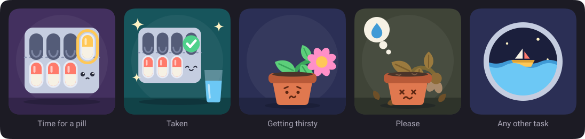

<div align="center">

# Housetide

**Recurring chores for Home Assistant, with a washing machine that actually rumbles.**

[](https://github.com/kriakiku/housetide/blob/main/LICENSE)


</div>

Housetide keeps your daily pills, weekly laundry and one-off errands in one place. A task can be a chain of steps, and a sensor can move it along for you: the laundry marks itself as started when the washer draws power, and turns into "hang it up" when the washer goes quiet.

Ignore a task and the scene lets you know about it.

## What it does

- **One-off and recurring tasks.** Daily, on chosen weekdays, every N days counted from the last time you did it, or on a fixed rhythm.
- **Chains of steps.** Load the washer, wash, hang it up. Each step can finish by hand or by a sensor.
- **Automatic steps.** A step finishes when an entity stays above or below a value, or in a given state, for as long as you say. A short pause in a wash cycle doesn't count.
- **Living scenes.** Laundry piles up, starts to smell, draws flies, shakes during the wash and sparkles when it's done. Pills and plants have their own, and everything else gets a tide that rises.
- **Its own sidebar page.** Today's tasks, a full editor with templates, and a history with a day grid, streaks and an on-time rate.
- **A dashboard card**, sensors for each task, a `todo` list, services and events for your own automations.

<p align="center">
  
</p>

<p align="center">
  
</p>

## Install

**With Marketplace (Home Assistant 2026.11 and newer).** Open `/marketplace`, choose **Add from link** and paste `https://github.com/kriakiku/housetide`. The first time, you are asked to connect GitHub with a short code. Install Housetide and restart Home Assistant.

**With HACS (older versions).** Add `https://github.com/kriakiku/housetide` under **Custom repositories** with the type **Integration**, download it and restart Home Assistant.

**By hand.** Copy `custom_components/housetide` to your `custom_components` folder and restart Home Assistant.

Then go to **Settings → Devices & services → Add integration** and pick **Housetide**. A new **Housetide** item appears in the sidebar.

## A washing machine that reports in

Create a task from the **Laundry** template in the sidebar page, and set the power sensor of the washer's smart plug on the first two steps.

| Step             | Finishes when                         | Then                 |
| ---------------- | ------------------------------------- | -------------------- |
| Collect and load | Power stays above 10 W for 60 seconds | The wash has started |
| Washing          | Power stays below 5 W for 300 seconds | The wash is over     |
| Hang it up       | You mark it done                      | The laundry is clean |

Use a sensor that reports **power in watts**. Voltage at a socket stays the same whether the washer runs or not. If your washer pauses for long during a cycle, raise the 300 seconds so that a pause doesn't end the step.

You can always finish a step by hand, and undo the last one. Starting the washer before the laundry is due simply starts it early.

## The dashboard card

```yaml
type: custom:housetide-card
show: today
layout: list
```

| Option       | Default | Description                                 |
| ------------ | ------- | ------------------------------------------- |
| `tasks`      | all     | Task ids to show.                           |
| `show`       | `today` | `today` or `all`.                           |
| `layout`     | `list`  | `list` for rows, `scenes` for large scenes. |
| `title`      | none    | A heading.                                  |
| `animations` | `true`  | Set to `false` for low-powered screens.     |

## For your automations

| Kind     | Name                                                                                                                           |
| -------- | ------------------------------------------------------------------------------------------------------------------------------ |
| Sensor   | One per task, the state is its status: `upcoming`, `due`, `overdue`, `in_progress`, `clean`, `done` or `disabled`              |
| Binary   | `binary_sensor.housetide_due`, on when something is due                                                                        |
| To-do    | `todo.housetide`, with today's tasks; completing one advances it                                                               |
| Services | `housetide.advance`, `housetide.skip`, `housetide.undo`                                                                        |
| Events   | `housetide_task_due`, `housetide_task_advanced`, `housetide_task_completed`, `housetide_task_skipped`, `housetide_task_missed` |

## Languages

The interface is in English and Ukrainian, and falls back to English. Dates and relative times follow your Home Assistant language.

## Development

You need [mise](https://mise.jdx.dev).

```sh
mise install
mise run setup
mise run check
```

The frontend bundle in `custom_components/housetide/frontend` is built by `bun run build` and committed. The behaviour is described in [SPEC.md](https://github.com/kriakiku/housetide/blob/main/SPEC.md).

## License

[MIT](https://github.com/kriakiku/housetide/blob/main/LICENSE)
